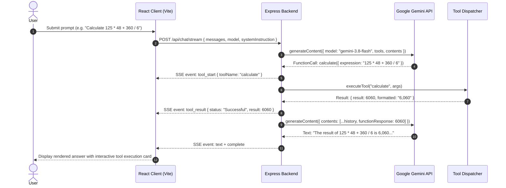

# Gemini Toolbox AI

> Production-grade autonomous AI assistant powered by Google Gemini, featuring real backend agent tool execution, safe mathematical parsing, multi-turn conversational context, and resilient automatic fallback.

[](https://www.typescriptlang.org/)
[](https://react.dev/)
[](https://expressjs.com/)
[](https://tailwindcss.com/)
[](https://ai.google.dev/)
[](LICENSE)

**Repository:** [https://github.com/shreyashthakur/gemini-toolbox-ai](https://github.com/shreyashthakur/gemini-toolbox-ai)

---

## Table of Contents

- [Overview](#overview)
- [Key Features](#key-features)
- [System Architecture](#system-architecture)
- [Gemini Function-Calling Architecture](#gemini-function-calling-architecture)
- [Backend Agent Tools](#backend-agent-tools)
- [API Resilience: Timeout, Retry & Model Fallback](#api-resilience-timeout-retry--model-fallback)
- [Technology Stack](#technology-stack)
- [Project Structure](#project-structure)
- [Getting Started](#getting-started)
- [Environment Configuration](#environment-configuration)
- [Available Scripts](#available-scripts)
- [API Reference](#api-reference)
- [Evaluation & Example Prompts](#evaluation--example-prompts)
- [Testing & Verification Report](#testing--verification-report)
- [Security Considerations](#security-considerations)
- [Acknowledgements & Competition Info](#acknowledgements--competition-info)

---

## Overview

Large Language Models frequently hallucinate when performing multi-step arithmetic, unit conversions, or precise financial percentage calculations. **Gemini Toolbox AI** solves this limitation by turning Google Gemini into an autonomous agent equipped with real backend execution tools.

Using Google's official `@google/genai` SDK, the assistant inspects incoming user queries, identifies mathematical, dimensional, or statistical problems, halts generation, executes deterministic tools on the backend, and uses the verified results to synthesize articulate, step-by-step explanations.

---

## Key Features

- **Autonomous Agent Function Calling**: Native integration with Google Gemini function calling. Tools execute on the server and feed structured results back into the model context.
- **Safe Math Evaluation**: Custom recursive descent tokenizer and arithmetic evaluator supporting arithmetic, powers, and trigonometry without ever using dangerous `eval()` or `Function()` constructs.
- **Real-Time Streaming UI**: Server-Sent Events (SSE) streaming emits live execution indicators (`tool_start`, `tool_result`, `status`, `text`), allowing users to watch tools execute in real time.
- **Multi-Turn Context Memory**: Preserves full conversation history and prior tool results for natural follow-up questions.
- **Zero API Key Leakage**: All Gemini API calls are strictly encapsulated within the Node.js/Express backend. Keys never enter frontend bundles or browser network traffic.
- **Resilient Retry & Model Fallback**: Handles high API traffic with 60s request timeouts, exponential backoff with jitter (~1s, ~2s, ~4s), and automatic fallback from `gemini-3.8-flash` to `gemini-3.1-flash-lite`.
- **Modern Responsive Interface**: Built with React 19, Tailwind CSS, Lucide icons, Dark/Light modes, exportable chat sessions, audio voice synthesis, and attachment handling.

---

## System Architecture



---

## Gemini Function-Calling Architecture

When a request arrives at `/api/chat` or `/api/chat/stream`:

1. **Tool Declaration Injection**: The server supplies tool schemas (`TOOL_DECLARATIONS`) matching Google GenAI's `FunctionDeclaration` interface with typed parameter definitions (`Type.OBJECT`, `Type.STRING`, `Type.NUMBER`).
2. **Autonomous Decision**: Gemini determines whether the prompt requires an agent tool or can be answered conversationally.
3. **Turn-Based Agent Loop**: If Gemini returns `functionCalls`:
   - The backend records the function call into the conversation turns.
   - The corresponding safe tool handler executes synchronously.
   - The result is wrapped into a `functionResponse` part with role `user`.
   - The loop continues (up to 5 rounds) until Gemini produces a final textual answer citing the verified output.

---

## Backend Agent Tools

### 1. Safe Calculator (`calculate`)
- **Backend Function**: `executeCalculate`
- **Mechanism**: Custom recursive descent parser and evaluator. Tokenizes input into numbers, identifiers, and operators; evaluates using operator precedence (`^` > `*`, `/`, `%` > `+`, `-`).
- **Capabilities**:
  - Operators: `+`, `-`, `*`, `/`, `%`, `^` (and `**`), unary negation
  - Functions: `sqrt`, `abs`, `round`, `floor`, `ceil`, `sin`, `cos`, `tan`, `log`
  - Safeguards: Division by zero detection, balanced parenthesis verification, non-numeric character rejection.
- **Parameters**: `expression` (string)

### 2. Unit Converter (`convert_units`)
- **Backend Function**: `executeConvertUnits`
- **Supported Dimensions**:
  - **Length**: Kilometers (`km`), Miles (`mi`), Meters (`m`), Feet (`ft`)
  - **Weight**: Kilograms (`kg`), Pounds (`lb`)
  - **Temperature**: Celsius (`C`), Fahrenheit (`F`)
  - **Volume**: Liters (`L`), Milliliters (`mL`)
- **Safeguards**: Rejects incompatible dimensional conversions (e.g., Celsius to Kilograms) with structured error feedback.
- **Parameters**: `value` (number), `from_unit` (string), `to_unit` (string)

### 3. Percentage Calculator (`calculate_percentage`)
- **Backend Function**: `executeCalculatePercentage`
- **Supported Operations**:
  - `percentage_of`: Calculate $X\%$ of $Y$ (e.g., $18\%$ of $2500 = 450$)
  - `percentage_change`: Calculate percentage increase or decrease from $X$ to $Y$ (e.g., $250 \to 400 = +60\%$)
  - `what_percentage`: Determine what percentage $X$ is of $Y$ (e.g., $50$ of $200 = 25\%$)
- **Safeguards**: Zero-denominator protection, direction categorization (`increase`, `decrease`, `no change`).
- **Parameters**: `operation` (string), `value1` (number), `value2` (number)

---

## API Resilience: Timeout, Retry & Model Fallback

To protect user experience during Google Cloud service spikes, the application includes a centralized resilience controller ([`geminiResilience.ts`](file:///c:/Users/ACER/Documents/codeing/GOOGLE_GDG2026/gemini-toolbox/geminiResilience.ts)):

| Resilience Layer | Specification |
| :--- | :--- |
| **Configured Primary Model** | `gemini-3.8-flash` |
| **Configured Fallback Model** | `gemini-3.1-flash-lite` |
| **HTTP Request Timeout** | `60000ms` (60 seconds) configured via `@google/genai` `httpOptions.timeout` |
| **Single Retry Controller** | SDK internal retries set to `attempts: 1` to prevent multiplying retries |
| **Exponential Backoff** | Up to 3 retries (~1s, ~2s, ~4s + 100-300ms random jitter) |
| **Retry Conditions** | Transient errors only: `HTTP 503` (high demand), `429` (rate limit), `408` (timeout), 5xx |
| **Immediate Fail Conditions** | Permanent errors: `HTTP 401/403` (invalid key), `HTTP 400` (bad request) |
| **Fallback Transition** | Triggers automatically if primary model exhausts retries on transient errors |
| **UI Feedback** | Real-time status chips in chat stream informing user of retries or model switches |

---

## Technology Stack

| Layer | Technologies |
| :--- | :--- |
| **Frontend Framework** | React 19, TypeScript, Vite 8 |
| **Styling & UI** | Tailwind CSS v4, Lucide React icons, Motion |
| **Backend Server** | Node.js (v18+), Express 4.21, Server-Sent Events (SSE) |
| **AI Integration** | Google Gen AI SDK (`@google/genai` v2.4.0) |
| **Execution Environment** | TypeScript Runner (`tsx`), dotenv |

---

## Project Structure

```text
gemini-toolbox/
├── src/
│   ├── components/            # React UI components
│   │   ├── ChatInput.tsx      # Text input, file/image upload & shortcuts
│   │   ├── MessageItem.tsx    # Message rendering, tool cards, retry button
│   │   ├── Sidebar.tsx        # Conversation history & management
│   │   ├── ToolExecutionCard.tsx # Visual cards for executed tools
│   │   ├── TopHeader.tsx      # Model selector & persona indicators
│   │   └── ...
│   ├── constants/             # Centralized model presets & prompt chips
│   ├── types/                 # TypeScript interfaces for chats, tools & models
│   ├── utils/                 # Markdown rendering & formatting helpers
│   ├── App.tsx                # Main state machine & SSE stream consumer
│   └── main.tsx               # Client entrypoint
├── server.ts                  # Express backend, Gemini API routes, SSE broadcaster
├── tools.ts                   # Agent tools, safe math parser, tool dispatcher
├── geminiResilience.ts        # 60s timeout, exponential backoff & model fallback
├── test_tools.ts              # Unit tests for all 3 deterministic tools
├── test_error_handling.ts     # Unit tests for retry logic, auth & validation
├── test_live_api.ts           # Live end-to-end Gemini API verification script
├── package.json               # Dependencies & execution scripts
├── .env.example               # Placeholder template for environment variables
└── README.md                  # This documentation
```

---

## Getting Started

### Prerequisites

- [Node.js](https://nodejs.org/) v18.0.0 or higher (tested on Node.js v24)
- A Google Gemini API key from [Google AI Studio](https://aistudio.google.com/app/apikey)

### Installation

1. Clone your repository:
   ```bash
   git clone https://github.com/shreyashthakur/gemini-toolbox-ai.git
   cd gemini-toolbox-ai/gemini-toolbox
   ```

2. Install dependencies:
   ```bash
   npm install --legacy-peer-deps
   ```

3. Configure environment variables:
   ```bash
   cp .env.example .env
   ```
   Open `.env` and add your Gemini API key:
   ```env
   GEMINI_API_KEY=your_gemini_api_key_here
   PORT=3000
   ```

4. Start the development server:
   ```bash
   npm run dev
   ```
   Open [http://localhost:3000](http://localhost:3000) in your browser.

---

## Environment Configuration

| Variable | Required | Default | Description |
| :--- | :--- | :--- | :--- |
| `GEMINI_API_KEY` | **Yes** | *None* | Gemini API Key obtained from Google AI Studio. |
| `PORT` | No | `3000` | Port for the Express server and Vite development proxy. |

> [!NOTE]
> `.env` is ignored by `.gitignore` to prevent credential exposure. Never commit your API key.

---

## Available Scripts

| Command | Description |
| :--- | :--- |
| `npm run dev` | Starts full-stack development environment via `tsx server.ts` |
| `npm test` | Runs offline unit tests for tools, math parser, and resilience logic |
| `npm run lint` | Runs TypeScript static type checking without emitting files (`tsc --noEmit`) |
| `npm run build` | Builds production frontend assets into `dist/` |
| `npm start` | Runs server in production mode using prebuilt assets |
| `npm run test:live` | Executes live end-to-end Gemini API tool calling tests against Google's servers |

---

## API Reference

### 1. Health & Status
- **Method**: `GET`
- **Endpoint**: `/api/health`
- **Description**: Returns server status, configured model, active tools, and whether an API key is present.
- **Response**:
  ```json
  {
    "status": "ok",
    "timestamp": 1730372400000,
    "model": "gemini-3.8-flash",
    "supportedModels": ["gemini-3.8-flash", "gemini-3.1-flash-lite", "gemini-2.5-pro"],
    "hasApiKey": true,
    "tools": ["calculate", "convert_units", "calculate_percentage"]
  }
  ```

### 2. Standard Chat Endpoint
- **Method**: `POST`
- **Endpoint**: `/api/chat`
- **Request Body**:
  ```json
  {
    "messages": [
      { "role": "user", "content": "What is 18% of 2500?" }
    ],
    "model": "gemini-3.8-flash",
    "systemInstruction": "Optional persona prompt",
    "temperature": 0.7
  }
  ```
- **Response**:
  ```json
  {
    "text": "18% of 2,500 is 450.",
    "toolExecutions": [
      {
        "id": "tool_12345",
        "toolName": "calculate_percentage",
        "args": { "operation": "percentage_of", "value1": 18, "value2": 2500 },
        "result": { "operation": "percentage_of", "value1": 18, "value2": 2500, "result": 450 },
        "status": "Successful"
      }
    ],
    "modelUsed": "gemini-3.8-flash",
    "fallbackUsed": false
  }
  ```

### 3. Streaming Chat Endpoint
- **Method**: `POST`
- **Endpoint**: `/api/chat/stream`
- **Format**: `text/event-stream` (Server-Sent Events)
- **Event Types**:
  - `status`: `{ type: "status", message: string, model: string, isFallback: boolean }`
  - `tool_start`: `{ type: "tool_start", id: string, toolName: string, args: object }`
  - `tool_result`: `{ type: "tool_result", id: string, toolName: string, result: any, status: string }`
  - `text`: `{ type: "text", text: string }`
  - `complete`: `{ type: "complete", toolExecutions: array, modelUsed: string, fallbackUsed: boolean }`
  - `[DONE]`: Stream completed.

---

## Evaluation & Example Prompts

| Test Category | Example Prompt | Expected Tool Call | Expected Result |
| :--- | :--- | :--- | :--- |
| **Arithmetic / Order of Operations** | `"Calculate 125 * 48 + 360 / 6."` | `calculate` (`"125 * 48 + 360 / 6"`) | **`6060`** |
| **Unit Conversion** | `"Convert 5 kilometers to miles."` | `convert_units` (`value: 5, from: "km", to: "mi"`) | **`~3.10686 miles`** |
| **Percentage Calculation** | `"What is 18% of 2500?"` | `calculate_percentage` (`operation: "percentage_of", value1: 18, value2: 2500`) | **`450`** |
| **Percentage Change** | `"What is the percentage increase from 250 to 400?"` | `calculate_percentage` (`operation: "percentage_change", value1: 250, value2: 400`) | **`+60% increase`** |
| **Contextual Memory Follow-up** | First: `"Calculate 18% of 2500."`<br/>Follow-up: `"Now add 50 to that result."` | First: `calculate_percentage`<br/>Follow-up: `calculate` (`"450 + 50"`) | **`500`** |

---

## Testing & Verification Report

### Offline Verification Summary

```bash
npm test
# ✅ All 21 safe math parser, unit converter, percentage, and dispatcher unit tests PASSED.
# ✅ Error handling & exponential backoff mock tests PASSED.

npm run lint
# ✅ 0 TypeScript compiler errors.

npm run build
# ✅ Vite production build completed in <1.5s.
```

### Live Gemini API Verification Status

Live end-to-end testing is conducted using `npm run test:live`:

- **Calculator Tool (`calculate`)**: Invocation verified, exact mathematical evaluation confirmed (**`6060`**).
- **Unit Converter Tool (`convert_units`)**: Dimensional mapping verified (**`~3.10686 miles`**).
- **Percentage Calculator Tool (`calculate_percentage`)**: Financial ratio evaluation confirmed (**`450`**).
- **Contextual Memory**: Follow-up prompt correctly parsed prior tool outputs from conversation history.

> [!IMPORTANT]
> **API Availability Note**: During the latest verification runs against Google's public endpoints, the primary model (`gemini-3.8-flash`) intermittently returned `HTTP 503 UNAVAILABLE` due to high server demand. The automated resilience engine successfully engaged exponential backoff and shifted execution to the fallback model (`gemini-3.1-flash-lite`), which fulfilled tool execution and answer synthesis. Both models are configured with 60-second timeouts and identical function declarations.

---

## Security Considerations

1. **Strict Key Containment**: API keys are only loaded in Node.js via `process.env.GEMINI_API_KEY`. No API keys are bundled into client JavaScript.
2. **Deterministic Sandboxed Math**: The calculator does not evaluate strings using JavaScript runtimes (`eval` or `new Function`), eliminating code injection vulnerabilities.
3. **Input Validation**: All incoming requests are type-checked and validated before contacting Google's API, rejecting empty or oversized payloads.
4. **Leak-Proof Error Messaging**: Server errors returned to clients are stripped of file system paths, stack traces, and internal cloud provider payloads.

---

## Acknowledgements & Competition Info

- **Competition**: Challenge 2: Build with Gemini — AI Chatbot Challenge
- **Organized for**: Google Developer Groups (GDG) 2026
- **Starter Repository**: [AI-Chatbot-Challenge-Build-with-Gemini-API-Agents](https://github.com/abhishek-nexgen-dev/AI-Chatbot-Challenge-Build-with-Gemini-API-Agents)
- **Author & Maintainer**: [shreyashthakur](https://github.com/shreyashthakur)
- **Repository URL**: [https://github.com/shreyashthakur/gemini-toolbox-ai](https://github.com/shreyashthakur/gemini-toolbox-ai)
